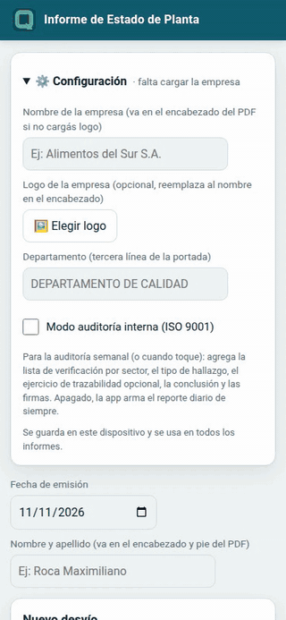

# Informe de Estado de Planta

App para armar el **Informe de Estado de Planta** (desvíos de calidad) desde el celular
durante la recorrida. Cargás cada desvío con sus fotos y la app genera un **PDF** prolijo,
con las fotos acomodadas solas, listo para mandar.

**Abrir la app:** https://roca-byte.github.io/informeCalidad/ · [Video (2:19)](docs/video/informeCalidad-demo.mp4) · [Guía de uso](docs/GUIA.md)

> ¿Querés verla funcionando sin cargar nada? Mirá el [video](docs/video/informeCalidad-demo.mp4)
> o la [guía con capturas](docs/GUIA.md): usan una empresa de ejemplo con datos inventados.

## Para qué sirve

Evita pasar en limpio el informe al final del turno: lo vas armando en la recorrida, con las
fotos sacadas en el momento, y al terminar tocás un botón y tenés el PDF.

## Qué podés hacer

- **Cargar desvíos en el momento**: sector (te sugiere los que ya usaste), fotos de la cámara
  o la galería, descripción y acciones correctivas.
- **Frases rápidas**: botones con frases típicas y tus propias frases guardadas (⭐), para no
  escribir todo. También podés dictar con el micrófono del teclado.
- **Fotos**: se achican solas para que el informe no pese, y podés reordenarlas o quitarlas.
- **Editar o eliminar** cada desvío antes de generar el informe.
- **PDF automático** con el formato de un informe de empresa:
  - Tu logo y una línea en el encabezado de cada página.
  - Portada con título, fecha, nombre y departamento, más el objetivo del informe.
  - Un bloque por desvío: descripción, fotos en grilla (sin recortar) y acciones correctivas.
  - Pie de página con fecha, nombre y número de página.
- **Modo auditoría interna** (opcional, ISO 9001; se activa en ⚙️ Configuración): lista de verificación por sector
  (Conforme / No conforme / No aplica / No verificado), tipo y número de cada hallazgo,
  ejercicio de trazabilidad, conclusión, firmas y la lista completa como anexo del PDF.
- **No perdés lo cargado**: si se cierra la app a mitad de la recorrida, el borrador queda guardado.
- **Modo claro u oscuro**, según tu celular.

## Cómo se usa

1. La primera vez se abre **⚙️ Configuración**: cargá el nombre de la empresa, el logo
   (opcional) y el departamento. Queda guardado para los próximos informes.
2. Completá la fecha y tu nombre.
3. Por cada desvío: sector, fotos, descripción y acción correctiva → **Agregar desvío**.
4. Al terminar la recorrida, tocá **Generar PDF**.
5. Para el próximo informe, tocá **Empezar informe nuevo**.

## Instalarla en el celular

1. Abrí el link de la app.
2. **Android (Chrome):** menú ⋮ → *Instalar app* (o *Agregar a la pantalla principal*).
   **iPhone (Safari):** botón Compartir → *Agregar a inicio*.
3. Listo: queda como una app más y, después de abrirla una vez, funciona sin señal.

## Tus datos

- Los desvíos y las fotos quedan **solo en tu dispositivo** hasta que generás el PDF. No hay
  cuentas ni servidor.
- Si borrás los datos del navegador, se pierde el borrador: generá el PDF antes de limpiar.

## Licencia

Libre para usar, copiar y modificar ([MIT](LICENSE)). © 2026 Maximiliano Roca.
Incluye [jsPDF](https://github.com/parallax/jsPDF) (licencia MIT).

---

Parte de la suite [**QualityOS**](https://github.com/roca-byte) · Información técnica para
modificarla: [DESARROLLO.md](DESARROLLO.md)
