# Guía de uso · Informe de Estado de Planta

Paso a paso para quien la usa por primera vez. Las capturas son de una empresa de ejemplo
("Planta Demo") con datos inventados, y las fotos son ilustraciones.

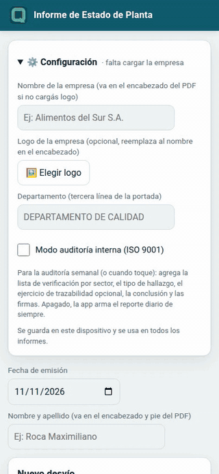

> También hay un [video de 2 minutos y 19 segundos](video/informeCalidad-demo.mp4) con todo el
> recorrido: el reporte diario, el PDF y el modo auditoría interna.

**Contenido**

1. [Abrirla e instalarla](#1-abrirla-e-instalarla)
2. [La primera vez: configuración](#2-la-primera-vez-configuración)
3. [Cargar un desvío](#3-cargar-un-desvío)
4. [Frases rápidas](#4-frases-rápidas)
5. [Revisar la lista antes de emitir](#5-revisar-la-lista-antes-de-emitir)
6. [Generar el PDF](#6-generar-el-pdf)
7. [Modo auditoría interna (ISO 9001)](#7-modo-auditoría-interna-iso-9001)
8. [El informe de auditoría](#8-el-informe-de-auditoría)
9. [Empezar un informe nuevo](#9-empezar-un-informe-nuevo)
10. [Preguntas frecuentes](#10-preguntas-frecuentes)

---

## 1. Abrirla e instalarla

Abrí **https://roca-byte.github.io/informeCalidad/**. No hace falta cuenta.

Para tenerla como una app: en **Android (Chrome)**, menú ⋮ → *Instalar app*; en **iPhone
(Safari)**, Compartir → *Agregar a inicio*. Después de abrirla una vez, funciona sin señal.

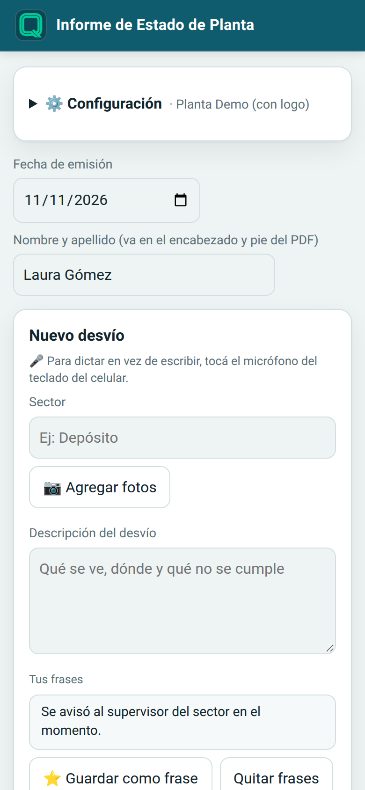

## 2. La primera vez: configuración

La primera vez se abre sola **⚙️ Configuración**. Lo que cargues ahí queda guardado en el
celular y se usa en todos los informes:

- **Nombre de la empresa**: va arriba en cada página del PDF si no cargás logo.
- **Logo**: PNG o JPG. La app lo achica sola y respeta el fondo transparente. Si lo cargás,
  reemplaza al nombre en el encabezado.
- **Departamento**: la tercera línea de la portada (por defecto, *Departamento de Calidad*).

Después el panel queda cerrado y muestra a qué empresa corresponde. Tocalo para cambiar algo.

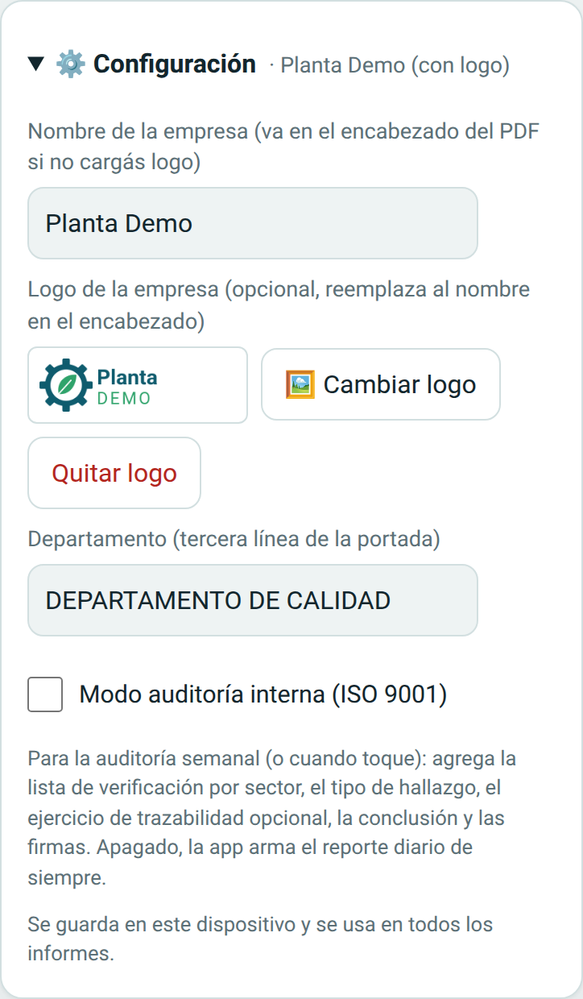

Debajo de la configuración completá la **fecha de emisión** (trae la de hoy) y tu **nombre y
apellido**, que van en la portada y en el pie de cada página.

## 3. Cargar un desvío

Cargá cada desvío **en el momento**, durante la recorrida:

1. **Sector**: escribilo o elegí uno de los que ya usaste (te los sugiere).
2. **📷 Agregar fotos**: sacalas con la cámara o elegilas de la galería; podés agregar varias.
   Se achican solas para que el PDF no pese. Con **◀ ▶** cambiás el orden y con **✕** quitás una.
3. **Descripción del desvío**: qué se ve, dónde y qué no se cumple. Para no escribir, tocá el
   micrófono del teclado del celular y dictalo.
4. **Acción correctiva propuesta**: una o dos acciones, **una por línea** (Enter entre cada
   una). En el PDF salen como viñetas.
5. Tocá **Agregar desvío**.

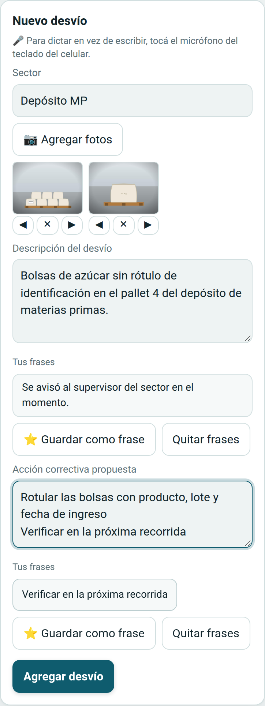

Lo que cargás queda guardado en el celular: si se cierra la app a mitad de la recorrida, al
abrirla está todo.

## 4. Frases rápidas

Debajo de la descripción y de la acción hay botones con frases. Tocar una **la agrega al
final** del texto (no lo reemplaza) para que completes con el dato concreto.

- **Tus frases**: escribí una frase en el campo y tocá **⭐ Guardar como frase**. En la acción,
  cada línea se guarda como una frase aparte. Para borrar alguna, **Quitar frases** y tocala.
- **Típicas del punto**: en el modo auditoría, al elegir un punto de la lista de verificación
  aparecen frases típicas de ese punto (ver [sección 7](#7-modo-auditoría-interna-iso-9001)).

## 5. Revisar la lista antes de emitir

Abajo están los **Desvíos de la recorrida**, en el orden en que van a salir en el PDF. En cada
uno podés **Editar**, subirlo o bajarlo con **↑ ↓**, o **Borrar**.

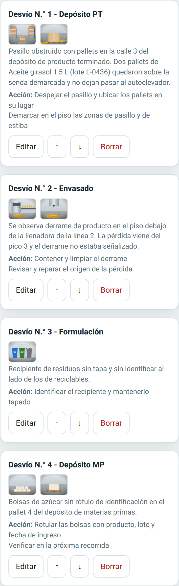

## 6. Generar el PDF

Al terminar la recorrida, tocá **Generar PDF**. Se descarga un archivo
`Reporte_Estado_de_Planta_aaaa-mm-dd.pdf`, listo para mandar por mail o WhatsApp.

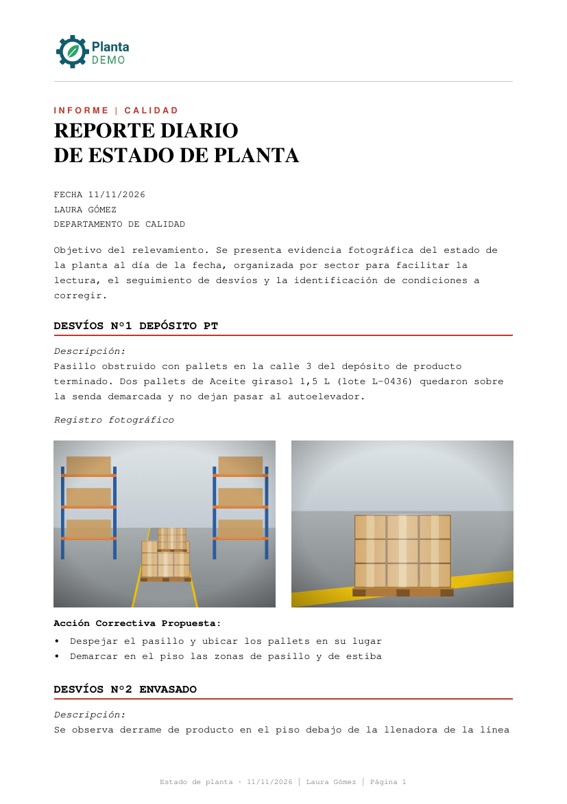 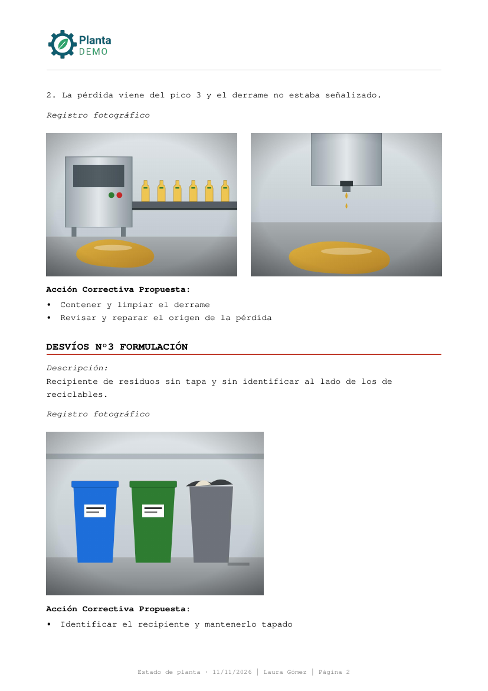

- **Encabezado** en cada página con tu logo (o el nombre de la empresa).
- **Portada** con el título, la fecha, tu nombre, el departamento y el objetivo del relevamiento.
- **Un bloque por desvío**: descripción, fotos en dos columnas (enteras, sin recortar) y las
  acciones correctivas en viñetas. Los desvíos van uno detrás del otro, sin empezar cada uno
  en una página nueva.
- **Pie** con la fecha, tu nombre y el número de página.

## 7. Modo auditoría interna (ISO 9001)

Para la auditoría semanal (o cuando toque), activá **Modo auditoría interna** en
⚙️ Configuración. Ahí aparecen además:

- **Código y revisión del registro** (por ejemplo `REG-01`, revisión `02`): van en la portada
  y en el pie.
- **Sectores de la planta**, uno por línea: se sugieren al cargar.

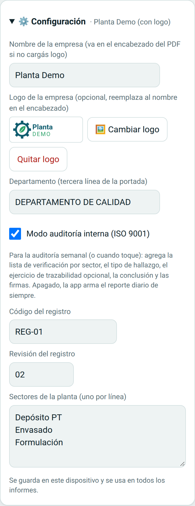

Apagado, la app vuelve al reporte diario de siempre.

### Datos de la auditoría

La **hora de inicio** se completa sola al activar el modo (la podés cambiar). En **Auditados**
anotá los responsables de sector presentes.

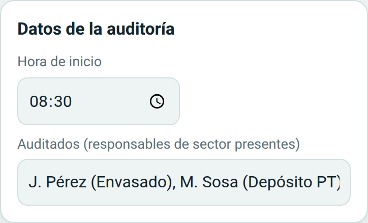

### Lista de verificación por sector

Escribí o elegí el **sector a verificar** y marcá cada punto: **C** (cumple), **NC** (no
cumple), **N/A** (no aplica) o **NV** (no verificado). Tocá de nuevo una marca para borrarla.

- Arriba de la lista ves el conteo del sector y el **% de cumplimiento = C / (C + NC)**.
- Cada sector auditado queda como un botón con su avance (por ejemplo `Envasado 30/30`) para
  volver a él.
- Al final del sector: producto o lote en línea, a quién se notifica si hay NC y el motivo de
  cada N/A y NV.

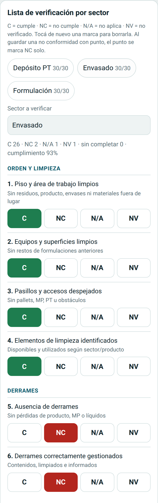

### Hallazgos

En el modo auditoría, cada desvío lleva además:

- **Tipo de hallazgo**: No conformidad, Observación u Oportunidad de mejora.
- **Punto de la lista** (opcional): muestra el **criterio de aceptación**, el **requisito de
  ISO 9001:2015** y frases típicas para la descripción y la acción.

Si guardás una **no conformidad con punto**, ese punto se marca **NC** solo en la lista del
sector. Cada hallazgo recibe un número por tipo y fecha, por ejemplo **NC-261111-01** u
**OBS-261111-01**: sirve para pasarlo al registro de no conformidades. Si reordenás los
hallazgos antes de emitir, se renumeran.

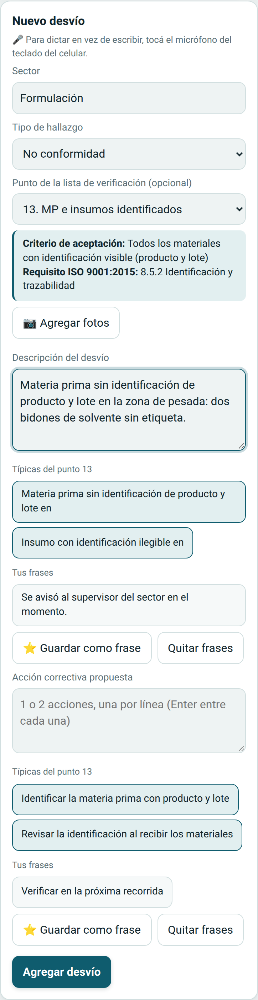

### Trazabilidad y conclusión

El **ejercicio de trazabilidad** es opcional: tildá *Incluir en este informe*, elegí un lote de
producto terminado y anotá hacia atrás (materias primas, lotes y proveedores) y hacia adelante
(despachos y clientes), cuánto tardaste en reunir la información y si el resultado es conforme.

Al final, escribí la **conclusión del auditor**.

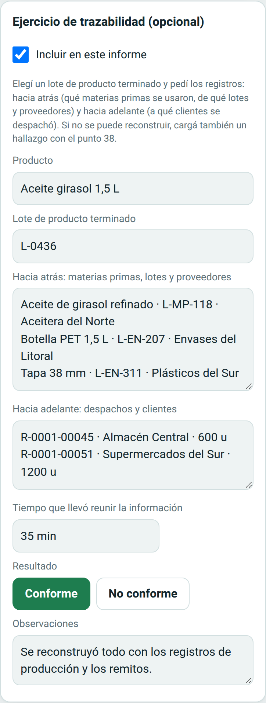 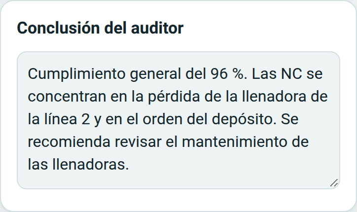

## 8. El informe de auditoría

Con el modo activado, **Generar PDF** descarga `Auditoria_Interna_aaaa-mm-dd.pdf` con:

1. **Portada**: código y revisión, fecha y hora, auditor, objetivo, alcance (los sectores
   auditados), criterios y auditados.
2. **Resultados por sector**: C, NC, N/A, NV, sin completar y % de cumplimiento, con el total.
3. **Hallazgos**, cada uno con su número, tipo, punto, requisito, descripción, fotos y acción.
4. **Ejercicio de trazabilidad** (si lo incluiste).
5. **Resumen por punto de la lista**: qué requisitos tuvieron hallazgos.
6. **Conclusión y firmas** del auditor y del responsable de calidad.
7. **Anexo**: la lista de verificación completa, con una columna por sector.

El pie de cada página dice *Página N de M*.

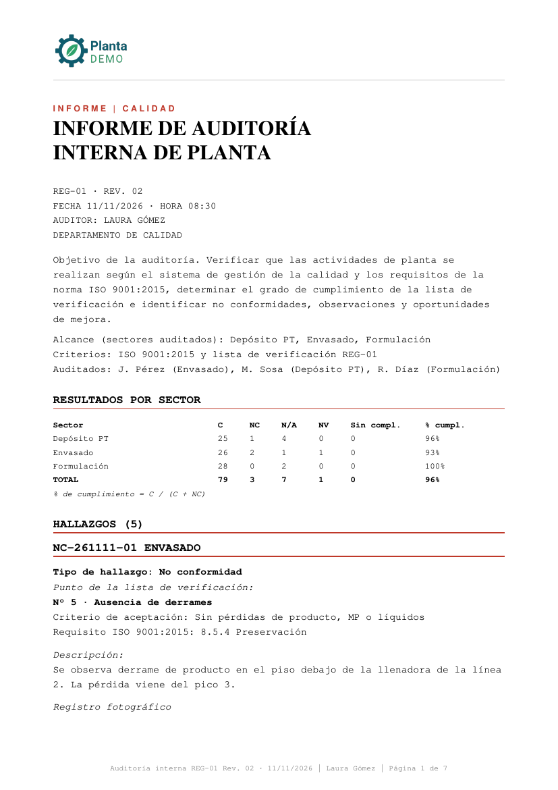 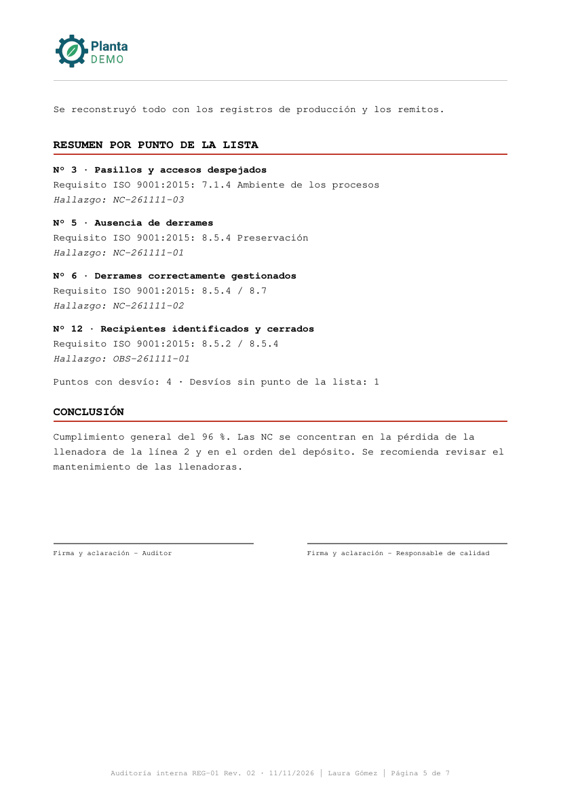 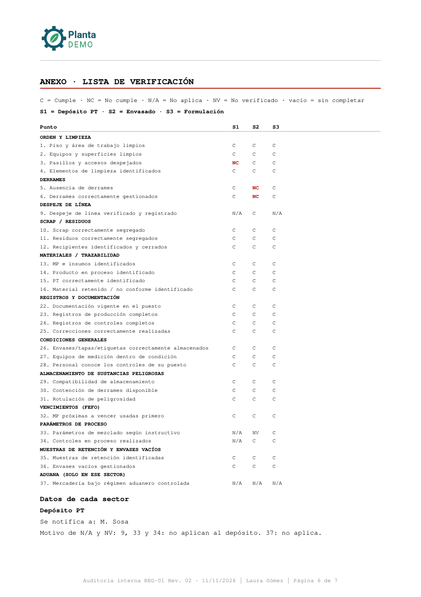

## 9. Empezar un informe nuevo

Cuando ya mandaste el PDF, tocá **Empezar informe nuevo**. Borra los desvíos cargados y, con el
modo auditoría activado, también la lista por sector, la trazabilidad y la conclusión.

**No** se borran la configuración (empresa, logo, departamento, código, sectores) ni tus frases
guardadas.

## 10. Preguntas frecuentes

**¿Funciona sin señal?**
Sí. Después de abrirla una vez con internet, carga y genera el PDF sin conexión.

**¿Dónde quedan mis datos y mis fotos?**
Solo en tu celular, hasta que generás el PDF. No hay cuentas ni servidor: nadie más los ve.

**¿Puedo perder lo que cargué?**
Si borrás los datos del navegador o desinstalás la app, se pierde el borrador. Generá el PDF
antes. Si el celular se queda sin espacio, la app te avisa: generá el PDF y empezá uno nuevo.

**¿Puedo usarla en la compu?**
Sí, en cualquier navegador. Está pensada para el celular, porque las fotos se sacan en la
recorrida.

**¿Puedo cambiar el título, el objetivo o el color del informe?**
Sí, pero desde el código (`brand.js`). Ver [GUIA_MARCA.md](../GUIA_MARCA.md).
